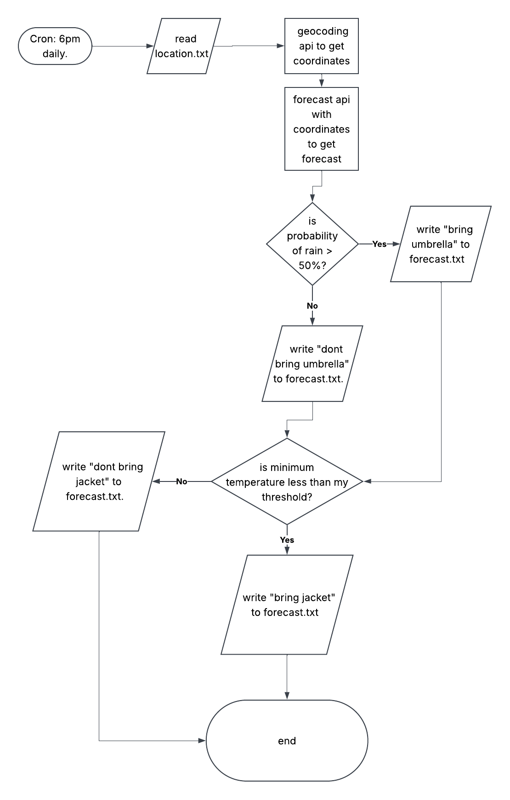

# Weather-advice

A python program that fetches weather data for West Lafayette every evening and writes to a text file whether you need a jacket or umbrella for tomorrow or not.

## The Problem

Every morning, I have to check whether it is cold enough that I have to bring a jacket or if it is going to rain so I have to bring an umbrella. Doing this every morning and scrolling to check the weather of every hour of the day can be tedious and some days I even forget.

## How It Works

The first version will:
- Read a city name from location.txt.
- Look up the location's latitude, longitude, and timezone using a geocoding API.
- Fetch tomorrow's weather forecast for that location.
- Compare tomorrow's minimum temperature against a fixed threshold to decide whether to recommend a jacket.
- Check the forecast for rain and recommend an umbrella when rain is expected. 
- Write recommendations to forecast.txt.
- This will run through a cron job every evening at 6PM.

## Tech Stack

- **Language:** Python
- **Libraries:** requests, datetime, pathlib
- **External tools:** cron, Open-Meteo Geocoding API, Open-Meteo Forecast API.

## Roadmap

Features you haven't built yet but plan to (pull these from your
"Schedule" quadrant in the Eisenhower Matrix).

- [ ] Desktop notifications
- [ ] Automatic location detection
- [ ] Dynamic jacket threshold based on response from user.

## Author

Dhrubo Khan, https://github.com/ihkdhrubo
