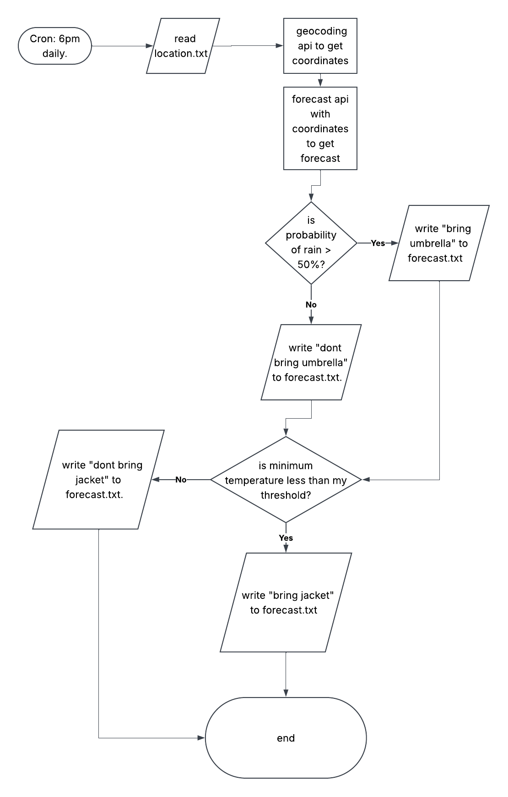
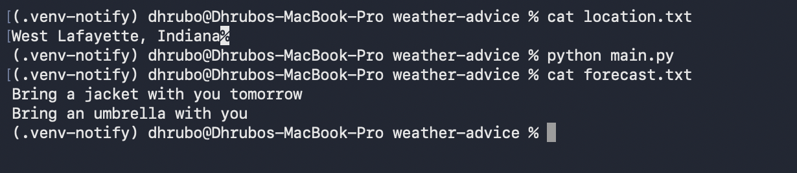
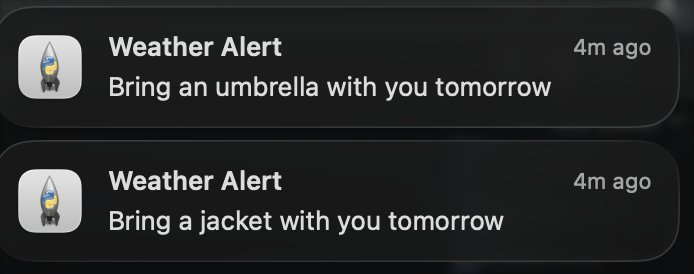

# Weather-advice

A python program that fetches weather data for West Lafayette every evening and writes to a text file whether you need a jacket or umbrella for tomorrow or not.

## The Problem

Every morning, I have to check whether it is cold enough that I have to bring a jacket or if it is going to rain so I have to bring an umbrella. Doing this every morning and scrolling to check the weather of every hour of the day can be tedious and some days I even forget.

## How It Works

The first version will:
- Read a city name from location.txt.
- Look up the location's latitude, longitude, and timezone using a geocoding API.
- Fetch tomorrow's weather forecast for that location.
- Compare tomorrow's minimum temperature against a fixed threshold to decide whether to recommend a jacket.
- Check the forecast for rain and recommend an umbrella when rain is expected. 
- Write recommendations to forecast.txt.
- This will run through a cron job every evening at 6PM.



## Tech Stack

- **Language:** Python
- **Libraries:** requests, desktop-notifier
- **External tools:** cron, Open-Meteo Geocoding API, Open-Meteo Forecast API.

## Requirements

- [Git](https://git-scm.com/downloads) to clone the repository
- [Python 3](https://www.python.org/downloads/) to run the program
- An internet connection to fetch data from [Open-Meteo](https://open-meteo.com/)

*On macOS, the commands below use Python 3.14 from the official python.org installer. This installer provides the signed Python executable needed for desktop notifications.*

## Setup

1. **Clone the repository.** Open Terminal on macOS or PowerShell on Windows and run:

   ```shell
   git clone https://github.com/ihkdhrubo/weather-advice.git weather-advice
   cd weather-advice
   ```

2. **Create a virtual environment and install the dependencies.** Run the commands for your operating system.

   **macOS · Terminal**

   ```bash
   /Library/Frameworks/Python.framework/Versions/3.14/bin/python3 -m venv .venv
   ./.venv/bin/python -m pip install requests desktop-notifier
   ```

   **Windows · PowerShell**

   ```powershell
   py -3 -m venv .venv
   .\.venv\Scripts\python.exe -m pip install requests desktop-notifier
   ```

3. **Set your city.** Create or edit `location.txt` in the `weather-advice` folder. Enter a single city name on one line:

   ```text
   West Lafayette
   ```

   The program uses the first matching city from Open-Meteo to find its coordinates and time zone.

## Run the program

From the `weather-advice` folder, run the commands for your operating system. The first command fetches the forecast. The second displays the recommendations saved in `forecast.txt`.

**macOS · Terminal**

```bash
./.venv/bin/python main.py
cat forecast.txt
```

**Windows · PowerShell**

```powershell
.\.venv\Scripts\python.exe main.py
Get-Content .\forecast.txt
```

Each successful run replaces the previous forecast and sends two **Weather Alert** notifications. If your computer asks for permission to display notifications, select **Allow**.

## Example input and output

**Input** in `location.txt`:

```text
West Lafayette
```

**Example output** in `forecast.txt`:

```text
Bring a jacket with you tomorrow
Do not bring an umbrella with you
```

*Your output will vary with the live forecast.* The program checks two conditions independently:

- **Jacket:** Bring one if any hour tomorrow has a feels-like temperature of **8°C or below**.
- **Umbrella:** Bring one if any hour tomorrow has a precipitation probability of **50% or higher**.




## Run Weather Advice automatically at 6 PM

Complete the setup above and run the program manually once before scheduling it. The schedule uses **6:00 PM in your computer’s local time zone**. Keep the computer awake, connected to the internet, and signed in to receive desktop notifications.

These examples assume your script is named `main.py` and your virtual environment is named `.venv`. If you use different names, substitute the ones that worked during your manual test.

### macOS: Schedule with cron

1. Open Terminal in the `weather-advice` folder. Run `pwd` and copy the full folder path it prints.

2. Open your personal cron schedule:

   ```bash
   EDITOR=nano crontab -e
   ```

3. Add the following as **one line** at the bottom. Replace `/full/path/to/weather-advice` with the path you copied. Keep the quotation marks so paths with spaces work.

   ```cron
   0 18 * * * cd "/full/path/to/weather-advice" && ./.venv/bin/python main.py >> weather-cron.log 2>&1
   ```

   `0 18 * * *` means **every day at 18:00**. The `cd` command puts the script in the folder containing `location.txt`. Any output or errors from Python go into `weather-cron.log`.

4. Press **Ctrl+O**, then **Enter** to save. Press **Ctrl+X** to exit. Run `crontab -l` to confirm the entry appears.

5. **Test the schedule:** Temporarily change `0 18` to a minute and hour a few minutes ahead. After that time, run `ls -l forecast.txt` in the project folder and check its modification time. Restore `0 18` after testing.

*If your Mac is asleep at 6 PM, cron skips that run.*

### Windows: Schedule with Task Scheduler

1. Open the `weather-advice` folder in File Explorer. Click the address bar and copy the full folder path.

2. Open **Task Scheduler** from the Start menu and select **Create Task**. Under **General**, name the task `Weather Advice` and select **Run only when user is logged on** so notifications can appear on your desktop.

3. Under **Triggers**, select **New**, choose **Daily**, set the start time to **6:00:00 PM**, and set it to recur every **1 day**. Select **OK**.

4. Under **Actions**, select **New** and choose **Start a program**. Fill in all three fields:

   - **Program/script:** Use **Browse** to select `.venv\Scripts\python.exe` inside the project folder.
   - **Add arguments:** Enter `main.py`.
   - **Start in:** Paste the full project folder path from step 1, without quotation marks. This is where Python will look for `location.txt` and write `forecast.txt`.

5. If you want the task to run while your laptop is on battery, open **Conditions** and clear **Start the task only if the computer is on AC power**. Select **OK** to save.

6. **Test the task:** Open **Task Scheduler Library**, right-click **Weather Advice**, and select **Run**. Check that `forecast.txt` has a new modification time and that it contains the jacket and umbrella recommendations.


## Roadmap

Features I haven't built yet but plan to

- [x] Desktop notifications
- [ ] Automatic location detection
- [ ] Dynamic jacket threshold based on response from user.


## Author

Dhrubo Khan, https://github.com/ihkdhrubo
